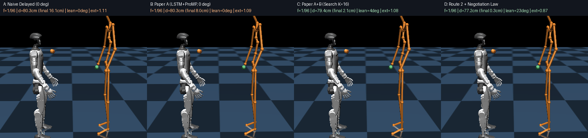
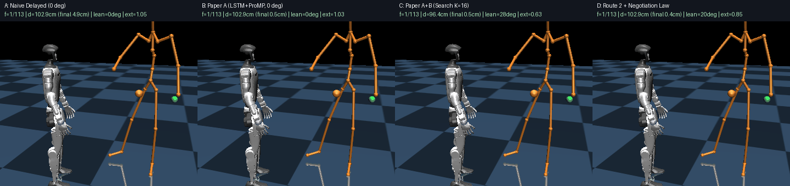

# Handshake Asymmetry

**Learning the negotiation law of human–human handshakes, to correct the inherent asymmetry of human–robot handshakes.**

> Status: **Implemented & evaluated on Unitree G1** (`src/`, 4-condition ablation over 324 Inter-X A001 pairs + side-by-side 3D demos in `demos/`).

---

## 0. Visual Demos & 4-Way Ablation (Route 2 + Negotiation Law)




*Left to right: **A** Naive delayed baseline (0° lean) → **B** Paper A (`2103.00616`: causal LSTM + Sigmoid blend + `ProMP.condition`, 0° lean) → **C** Paper A + Paper B (`2610.15274`: $K=16$ embodiment-aware search) → **D** **Route 2 + Negotiation Law** (25° empirical torso lean + `[0.84, 0.90]` comfort extension band). Spheres: **Green** = true partner palm, **Yellow** = causal LSTM predicted final clasp point, **Red** = Sigmoid blended target, **Purple** = G1 hand.*

### Held-out G-group test split results (142 valid ipsilateral contact pairs: train=85 / val=29 / test=28)

| Condition | Terminal Palm Error (med) ↓ | Success (≤5 cm & valid) ↑ | Anatomical & Collision Valid ↑ | Extension Ratio (med) | In Human Comfort Band `[0.84, 0.90]` ↑ | Residual Partner Concession (med) ↓ |
|---|---:|---:|---:|---:|---:|---:|
| **A: Naive Delayed (`K=1`, 0° lean)** | 19.03 cm | 7.1 % | 100.0 % | 0.956 | 10.7 % | 3.16 cm |
| **B: Paper A (`LSTM + ProMP.condition`, 0°)** | 2.41 cm | 53.6 % | 100.0 % | 0.928 | 17.9 % | 2.89 cm |
| **C: Paper A + Paper B (`K=16` Search)** | 0.92 cm | **92.9 %** | **100.0 %** | 0.977 | 7.1 % | 0.00 cm |
| **D: Route 2 + Negotiation Law (Ours)** | **0.45 cm** | 89.3 % | **100.0 %** | **0.872** | **50.0 %** | **0.00 cm** |

---

## 1. The claim

Human–robot physical interaction has an **inherent asymmetry**: the human is real, the robot is not,
and almost every method silently asks the *robot* to absorb **all** of the mismatch in body size,
arm length, stiffness, perception and timing.

We argue the asymmetry is not the problem — **one-sided adaptation is**. Real humans shake hands
with partners up to 30 cm taller or shorter, and they do it by **splitting** the mismatch between
both bodies. That split is measurable, and it can be turned into a constraint for robot control.

We measured it from real human–human handshakes, then quantified what a humanoid would need.

---

## 2. Key measurements (all reproducible with `analysis/`)

### 2.1 The handshake negotiation law (324 pairs / 58 dyads / 116 distinct people)

| height difference Δh | n | height ratio | clasp height | standoff | shorter partner's arm extension | lean (short / tall) |
|---|---:|---:|---:|---:|---:|---:|
| < −10 cm | 18 | 0.866 | **101.7 cm** | 88.2 cm | 84.9 % | 24.3° / 24.2° |
| −10 … −4 cm | 13 | 0.964 | 102.0 cm | 80.5 cm | 90.3 % | 20.9° / 28.2° |
| ±4 cm | 67 | 1.005 | 100.6 cm | 83.8 cm | 86.9 % | 23.8° / 25.3° |
| +4 … +10 cm | 30 | 1.052 | 97.6 cm | 83.8 cm | 87.1 % | 23.9° / 27.1° |
| > +10 cm | 61 | 1.156 | **95.0 cm** | 88.4 cm | 87.9 % | 22.6° / 27.6° |

Five regularities:

1. **The clasp height is an absolute social constant**, not a scaled quantity: it moves only
   **6.7 cm** while the height difference spans 30+ cm.
2. **Horizontally the clasp sits at the midpoint of the two bodies** (λ = 0.493 along the
   pelvis–pelvis line): horizontal adaptation is already symmetric.
3. **Standoff is 80–88 cm and grows when the mismatch is large** — people do *not* step closer
   to compensate; they stand slightly farther and reach up.
4. **Both partners lean their torso forward 22–28°, the taller one leans more.**
5. **Both extend to 84–90 % of their arm length** — nobody keeps a reserve.

### 2.2 What the asymmetry actually costs a humanoid

| | height | shoulder height | arm (shoulder→wrist) |
|---|---:|---:|---:|
| human (SMPL-X neutral) | 149.7 cm | 131.4 cm | **52.1 cm** |
| Unitree G1 (from `g1_29dof.xml`) | 132.0 cm | 108.5 cm | **38.7 cm** |
| difference | −17.7 cm | **−22.9 cm** | **−13.4 cm (74 % of human)** |

The arm ratio (74 %) is worse than the height ratio (88 %) — **the binding constraint is the
short arm, not the low stature.**

Required shoulder→clasp distance over 8,134 real contact frames, as a function of how much the
robot leans:

| robot lean | required (median) | p90 | exceeds arm | **reachable frames** |
|---|---:|---:|---:|---:|
| **0° (naive retargeting)** | 41.3 cm | 48.6 cm | 68 % | **32 %** |
| 15° | 36.0 cm | 43.3 cm | 31 % | 69 % |
| **25° (the lean humans actually use)** | 32.7 cm | 40.1 cm | 13 % | **87 %** |
| 35° | 29.8 cm | 37.5 cm | 7 % | 93 % |

**Torso lean alone takes reachability from 32 % to 87 %.** The remaining 13 % needs only a
median **3.2 cm concession** from the partner (p90 12.4 cm) — the same order of magnitude humans
already concede to each other.

### 2.3 Why this is not "a reaching problem"

We originally framed this as "the robot cannot reach". That framing missed the point:
a 0°-lean evaluation makes it look structurally impossible, but humans *always* lean.
The real statement is:

> The mismatch is absorbable **if and only if** it is split the way humans split it.
> One-sided absorption is what fails.

---

## 3. What we propose

Split the pipeline into three layers and give each layer its own share of the asymmetry:

| layer | what it does | what it contributes here |
|---|---|---|
| **Generation** | produce interaction references | learn the **concession prior** (vertical yield ratio ≈ 0.22, horizontal ≈ 0) |
| **Retargeting** | map human reference → robot morphology | solve the **negotiation target** (clasp height ≈ 100 cm, λ ≈ 0.5, robot lean 22–28°) |
| **Deployment** | closed loop with the real partner | execute **two-sided concession** (median 3.2 cm residual) |

Concretely: the retargeter should not only output a trajectory but also a **concession request**
("I can absorb 3.6 cm; please lower your hand / step in by 3.2 cm"), and the runtime layer should
negotiate that with the partner instead of silently stretching the robot to its limit.

This also replaces a hand-set hyper-parameter in prior work: *Beyond Mimicry* (PAIR) lets the
partner's upper body adapt through `w_hum`, but the weight is tuned by hand. Our measured law
supplies a data-driven value for it.

---

## 4. Repository map

```
src/                          ★ Mainline method implementation (ProMP + LSTM + K=16 Search + Negotiation Law)
  config.py                   paths, SMPL-X joint indices, G1 & negotiation law constants
  data_prep.py                raw_betas FK + per-person grounding + ipsilateral pair filtering + G-group split
  promp.py                    Layer P: minimum-jerk 8-RBF ProMP fit, sampling, Bayesian conditioning
  predictor_lstm.py           Layer D: causal heading-aligned LSTM partner predictor + Sigmoid blend
  g1_kinematics.py            Layer R/D: MuJoCo G1 nullspace DLS IK, anatomical bounds, collision check
  reaction_search.py          Layer R: K=16 embodiment-aware search + negotiation comfort band
  run_pipeline.py             end-to-end training & 4-condition ablation
  view_viser.py               live interactive 3D Viser web viewer
  record_demos.py             exports .viser 3D recordings + 4-panel MP4/GIF/PNG demos
demos/                        ★ Recorded 4-way comparison GIFs, MP4s, keyframes, .viser scenes & metrics
  G049T000A001R007_compare4.{gif,mp4} / _contact_frame.png / _D_route2.viser
  G059T000A001R005_compare4.{gif,mp4} / _contact_frame.png / _D_route2.viser
  G013T000A001R008_compare4.{gif,mp4} / _contact_frame.png / _D_route2.viser
  G023T000A001R008_compare4.{gif,mp4} / _contact_frame.png / _D_route2.viser
  ablation_metrics.json       full JSON metrics of the 4-way Route 2 ablation
analysis/                     ★ Empirical negotiation-law & dataset quality audit scripts
  smplx_fk.py                 SMPL-H loading + SMPL-X forward kinematics (Y-up caveat inside)
  law_handshake_geometry.py   measures the five regularities -> law.json
  reachability_lean.py        measures reach vs lean + required concession -> reach.json
  audit_pairs.py              12-point quality audit for paired motion data -> audit.json
docs/                         ★ Research notes, literature survey & PDF reports
  00-overview.md              one-page idea
  01-problem-and-framing.md   asymmetry, three layers, what prior work assumes
  02-handshake-geometry-law.md  the five laws, with the measurement protocol
  03-methods-survey.md        24-paper HRI survey, method families, who-adapts-to-whom gap
  04-proposed-method.md       three knobs + concession law + experiment plan + risks
  05-data-and-audit.md        8 interaction datasets, 12-point quality audit, data pitfalls
  reports/                    compiled PDF survey & verification reports
    report-data-verification.pdf
    report-methods-survey.pdf
    analysis-three-layers.pdf
```

---

## 5. Quickstart

Requirements: `numpy`, `torch`, `smplx`, `mujoco`, `viser`, `yourdfpy`, and an `SMPLX_NEUTRAL.npz` model file (registration
required upstream). Input data is any two-person motion set in the SMPL-H 52-joint layout,
paired as `*_P1.npz` / `*_P2.npz` with a `raw_betas` field.

```bash
# 1) Run the mainline pipeline (ProMP + LSTM + K=16 Search + Negotiation Law)
python src/run_pipeline.py --epochs 80 --k-search 16 --work-dir runs/handshake_route2

# 2) Launch interactive 3D Viser web viewer or export 4-panel demo videos
python src/view_viser.py --vis runs/handshake_route2/route2_vis.npy --port 8091
python src/record_demos.py --vis runs/handshake_route2/route2_vis.npy --out-dir demos

# 3) Optional: reproduce the empirical negotiation laws & dataset audit
python analysis/law_handshake_geometry.py \
    --data-root /path/to/handshake_pairs \
    --model /path/to/SMPLX_NEUTRAL.npz \
    --out law.json

python analysis/reachability_lean.py \
    --data-root /path/to/handshake_pairs \
    --model /path/to/SMPLX_NEUTRAL.npz \
    --out reach.json

python analysis/audit_pairs.py \
    --root /path/to/handshake_pairs \
    --model /path/to/SMPLX_NEUTRAL.npz \
    --out audit.json --workers 8
```

Data used for the numbers in this repository: the `Handshake` (A001) subset of **Inter-X**
(324 pairs). `CHI3D` (`Handshake`) and `Hi4D` are kept as independent cross-validation sets.

---

## 6. Data Preprocessing Notes

1. **Use `raw_betas` for real body shapes**: Shipped `betas` are zeroed out (identical neutral skeletons); running SMPL-X FK with `raw_betas` restores the true 32 cm height range.
2. **Per-person ground alignment**: Raw pairs only ground the lower person (leaving the partner floating by ~6.4 cm median); we independently align each person's lowest foot to `z = 0`.

See `docs/05-data-and-audit.md` for the full dataset audit.

---

## 7. Relationship to prior work

24 human–robot interaction papers were surveyed. Distribution of *who adapts*:

| how adaptation is allocated | papers |
|---|---:|
| robot absorbs everything, partner fixed | **14** |
| partner predicted/modelled but not asked to move | 4 |
| partner may adapt — but the weight is hand-tuned | **1** (PAIR / `w_hum`) |
| explicit role assignment (task level, not contact level) | 2 |
| mechanical compliance absorbs the difference | 1 |

Only **one** paper spans all three layers (generation + retargeting + deployment). The
layer-to-layer seams are exactly where our contribution sits. See `docs/03-methods-survey.md`.

---

## 8. License

MIT — see `LICENSE`. The motion data itself keeps its upstream licenses and is **not** included
in this repository.
